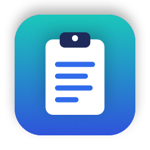

<p align="center">
  
</p>

<h1 align="center">MacClipboard</h1>

<p align="center">
  A free, private clipboard manager for your Mac.<br/>
  Remembers everything you copy, so you can find it and paste it again in a second.
</p>

<p align="center">
  <a href="https://github.com/mk-manishkandel/MacClipboard/releases/latest/download/MacClipboard.zip"><b>⬇️ Download MacClipboard for Mac</b></a><br/>
  <sub>Free · Open source · macOS 14 Sonoma or newer · Apple silicon and Intel</sub><br/>
  <a href="CHANGELOG.md">What's new</a> · <a href="https://github.com/mk-manishkandel/MacClipboard/releases">All releases</a>
</p>

<p align="center">
  <a href="https://github.com/mk-manishkandel/MacClipboard/releases/latest"></a>
  <a href="https://github.com/mk-manishkandel/MacClipboard/releases"></a>
  <a href="LICENSE"></a>
  <a href="https://github.com/mk-manishkandel/MacClipboard/actions/workflows/ci.yml"></a>
</p>

## Why MacClipboard

* **Never lose something you copied.** Every text, link, image and file you copy is saved in a searchable history.
* **Paste in one click.** Press <kbd>⇧</kbd><kbd>⌘</kbd><kbd>C</kbd>, pick an item, and it is pasted straight into the text field you are typing in.
* **Private by design.** Your history never leaves your Mac and is encrypted on disk. No accounts, no tracking, no cloud.
* **Forgets your secrets.** Passwords, API keys, card numbers and one-time codes are removed after 30 seconds, and
  old history can be deleted automatically after a day, a week or a month.
* **Text tools.** Right-click any item to paste it as UPPERCASE, lowercase, Title Case, with spaces trimmed,
  with lines joined, as pretty JSON, or as a link without tracking codes.
* **Snippets.** Save text you use often, like your address or a standard reply, and paste it any time.
* **Find things fast.** Search as you type, or use the tabs to show only text, links, images, files or snippets.
* **Updates itself.** New versions install automatically, and every update is cryptographically verified.

## Install

1. **[Download MacClipboard.zip](https://github.com/mk-manishkandel/MacClipboard/releases/latest/download/MacClipboard.zip)** and double-click it to unzip.
2. Drag **MacClipboard.app** into your **Applications** folder.
3. Open it. MacClipboard is free and not notarized by Apple (that requires a paid developer account), so macOS blocks it the first time:
   * **macOS 15 Sequoia or newer:** click **Done** on the warning, open **System Settings → Privacy & Security**,
     scroll down and click **Open Anyway** next to *"MacClipboard was blocked"*, then confirm with your password.
   * **macOS 14 Sonoma:** right-click the app, choose **Open**, then click **Open** again.
   * **Using Terminal instead:** `xattr -dr com.apple.quarantine /Applications/MacClipboard.app`
4. The first time you pick an item, macOS asks for **Accessibility** permission. Click **Open System Settings** and
   turn on **MacClipboard**. This lets it paste for you.
   * **Not pasting?** Reset the permission and turn it on again:
     ```sh
     tccutil reset Accessibility com.mkmanishkandel.MacClipboard
     open "x-apple.systempreferences:com.apple.preference.security?Privacy_Accessibility"
     ```
5. Look for the clipboard icon in your menu bar. You are ready to go.

**Homebrew:**

```sh
brew tap mk-manishkandel/tap
brew trust mk-manishkandel/tap
brew install --cask macclipboard
```

**Updates:** MacClipboard checks for new versions and shows what changed before installing
(see [What's new](CHANGELOG.md)). You can also check any time in
**Settings → General → Check now**.

**Uninstall:** quit MacClipboard from its menu, drag it from Applications to the Trash, and optionally delete
`~/Library/Containers/com.mkmanishkandel.MacClipboard` to remove your history.

## Quick start

| To do this | Press |
|---|---|
| Open your clipboard history | <kbd>⇧</kbd> <kbd>⌘</kbd> <kbd>C</kbd> or click the menu bar icon |
| Search | Just start typing |
| Paste the selected item | <kbd>Enter</kbd> or click it |
| Copy it without pasting | <kbd>⌥</kbd> <kbd>Enter</kbd> or <kbd>⌥</kbd>-click |
| Paste without formatting | <kbd>⇧</kbd> <kbd>⌘</kbd> <kbd>Enter</kbd> |
| Pin an item to the top | <kbd>⌥</kbd> <kbd>P</kbd> |
| Delete an item | <kbd>⌥</kbd> <kbd>⌫</kbd> |
| Paste as UPPERCASE, pretty JSON, clean link… | Right-click an item → **Paste as** |
| Show the full item and its details | <kbd>⌃</kbd> <kbd>Space</kbd> |
| Add a snippet | Menu bar icon → **New Snippet…** |
| Open settings | <kbd>⌘</kbd> <kbd>,</kbd> |

MacClipboard is an independent fork of [Maccy](https://github.com/p0deje/Maccy) by Alex Rodionov, used under the
MIT License, and is not affiliated with or endorsed by the Maccy project. See [Credits and license](#credits-and-license).

## Privacy

* Clipboard history is stored **only on your Mac**, inside the app's sandbox container:
  `~/Library/Containers/com.mkmanishkandel.MacClipboard/Data/Library/Application Support/MacClipboard/Storage.sqlite`.
* The copied contents and titles in that database are **encrypted with AES-256-GCM**. The key is generated on first
  launch and kept in your login Keychain, so the file is unreadable to other apps, backups or anyone who copies it.
* Copies that look like passwords, API keys, credit card numbers or one-time codes are removed from history after
  30 seconds (or never saved, if you prefer). Copies that password managers mark as private are never saved.
* **Settings → Storage → Keep history for** removes unpinned items after 1 hour, 1 day, 7 days or 30 days.
* There is no analytics, telemetry, crash reporting or cloud sync.
* The only network request the app makes is the optional update check. It downloads
  [`appcast.xml`](appcast.xml) from this repository and, if you accept an update, the release zip from GitHub Releases.
  Nothing about your clipboard is sent. You can turn the check off in **Settings → General → Check for updates**.

## Features

### Clipboard history
* Saves text, rich text, links, images and files you copy, with the app each one came from.
* Search as you type. Results update instantly, even with thousands of items.
* Filter tabs under the search field: **All**, **Text**, **Links**, **Images**, **Files** and **Snippets**.
* Pin important items to the top, each with its own keyboard shortcut.
* Press <kbd>⌃</kbd> <kbd>Space</kbd> to see the full item, a large image preview, where it was copied from and when.

### Pasting
* Pastes the item straight into the app you were using. Turn this off in **Settings → General → Paste automatically**
  if you only want it copied.
* Paste without formatting with <kbd>⇧</kbd> <kbd>⌘</kbd> <kbd>Enter</kbd>.
* **Paste as** (right-click an item):

  | Option | What it does |
  |---|---|
  | UPPERCASE / lowercase / Title Case | Changes the letter case |
  | Trim spaces | Removes extra spaces at the start and end of lines and between words |
  | Join lines | Turns several lines into one |
  | Pretty JSON | Formats JSON so it is easy to read |
  | Clean link | Removes tracking codes such as `utm_source`, `fbclid` and `gclid` from a link |

  Options that would not change the item are hidden.

### Snippets
* Click the menu bar icon and choose **New Snippet…** to save text you paste often.
* Snippets stay pinned at the top. **Clear** keeps them; only **Clear all** removes them.
* Open the **Snippets** tab to see only your snippets.

### Privacy and security
* History is stored only on your Mac and encrypted with AES-256-GCM. The key lives in your Keychain.
* Detects passwords, API keys, private keys, credit card numbers and one-time codes, and removes them after
  30 seconds. In **Settings → Storage** you can choose to never save them, or to keep them like anything else.
* Never saves copies that password managers mark as private.
* **Keep history for** forever, 30 days, 7 days, 1 day or 1 hour. Pinned items and snippets are always kept.
* Pause saving copies by <kbd>⌥</kbd>-clicking the menu bar icon.
* No accounts, analytics or cloud sync.

### Everyday use
* Click the menu bar icon for a menu with **History**, **New Snippet…**, **Settings…**, **About** and **Quit**.
* Choose your own shortcut, popup position, theme and how many items to keep.
* Updates download and install automatically, and each one is verified with a digital signature.
* Native, lightweight and free. Runs on Apple silicon and Intel Macs with macOS 14 or newer.

## Full usage guide

1. <kbd>SHIFT (⇧)</kbd> + <kbd>COMMAND (⌘)</kbd> + <kbd>C</kbd> to popup MacClipboard or click on its icon in the menu bar.
2. Type what you want to find.
3. To paste the history item into the app you were using, press <kbd>ENTER</kbd>, or click the item, or use <kbd>COMMAND (⌘)</kbd> + `n` shortcut.
4. To only copy the history item without pasting, press <kbd>OPTION (⌥)</kbd> + <kbd>ENTER</kbd>, or <kbd>OPTION (⌥)</kbd> + <kbd>CLICK</kbd> the item, or use <kbd>OPTION (⌥)</kbd> + `n` shortcut.
5. To paste the history item without formatting, press <kbd>COMMAND (⌘)</kbd> + <kbd>SHIFT (⇧)</kbd> + <kbd>ENTER</kbd>, or <kbd>COMMAND (⌘)</kbd> + <kbd>SHIFT (⇧)</kbd> + <kbd>CLICK</kbd> the item.

   To go back to copy-only behavior, turn off **Settings → General → Paste automatically**.
6. To delete the history item, press <kbd>OPTION (⌥)</kbd> + <kbd>DELETE (⌫)</kbd>.
7. To see the full text of the history item, wait a couple of seconds for tooltip.
8. To pin the history item so that it remains on top of the list, press <kbd>OPTION (⌥)</kbd> + <kbd>P</kbd>. The item will be moved to the top with a random but permanent keyboard shortcut. To unpin it, press <kbd>OPTION (⌥)</kbd> + <kbd>P</kbd> again.
9. To clear all unpinned items, select _Clear_ in the menu, or press <kbd>OPTION (⌥)</kbd> + <kbd>COMMAND (⌘)</kbd> + <kbd>DELETE (⌫)</kbd>. To clear all items including pinned, select _Clear_ in the menu with  <kbd>OPTION (⌥)</kbd> pressed, or press <kbd>SHIFT (⇧)</kbd> + <kbd>OPTION (⌥)</kbd> + <kbd>COMMAND (⌘)</kbd> + <kbd>DELETE (⌫)</kbd>.
10. To disable MacClipboard and ignore new copies, click on the menu icon with <kbd>OPTION (⌥)</kbd> pressed.
11. To ignore only the next copy, click on the menu icon with <kbd>OPTION (⌥)</kbd> + <kbd>SHIFT (⇧)</kbd> pressed.
12. To customize the behavior, check "Settings…" window, or press <kbd>COMMAND (⌘)</kbd> + <kbd>,</kbd>.

## Advanced

### Ignore Copied Items

You can tell MacClipboard to ignore all copied items:

```sh
defaults write com.mkmanishkandel.MacClipboard ignoreEvents true # default is false
```

This is useful if you have some workflow for copying sensitive data. You can set `ignoreEvents` to true, copy the data and set `ignoreEvents` back to false.

You can also click the menu icon with <kbd>OPTION (⌥)</kbd> pressed. To ignore only the next copy, click with <kbd>OPTION (⌥)</kbd> + <kbd>SHIFT (⇧)</kbd> pressed.

### Ignore Custom Copy Types

By default MacClipboard will ignore certain copy types that are considered to be confidential
or temporary. The default list always include the following types:

* `org.nspasteboard.TransientType`
* `org.nspasteboard.ConcealedType`
* `org.nspasteboard.AutoGeneratedType`

Also, default configuration includes the following types but they can be removed
or overwritten:

* `com.agilebits.onepassword`
* `com.typeit4me.clipping`
* `de.petermaurer.TransientPasteboardType`
* `Pasteboard generator type`
* `net.antelle.keeweb`

You can add additional custom types using settings.
To find what custom types are used by an application, you can use
free application [Pasteboard-Viewer](https://github.com/sindresorhus/Pasteboard-Viewer).
Simply download the application, open it, copy something from the application you
want to ignore and look for any custom types in the left sidebar. [Here is an example
of using this approach to ignore Adobe InDesign](https://github.com/p0deje/Maccy/issues/125).

### Speed up Clipboard Check Interval

By default, MacClipboard checks clipboard every 500 ms, which should be enough for most users. If you want
to speed it up, you can change it with `defaults`:

```sh
defaults write com.mkmanishkandel.MacClipboard clipboardCheckInterval 0.1 # 100 ms
```

## FAQ

### Why doesn't it paste when I select an item in history?

1. Make sure you have "Paste automatically" enabled in Preferences.
2. Make sure "MacClipboard" is added to System Settings -> Privacy & Security -> Accessibility.

### When assigning a hotkey to open MacClipboard, it says that this hotkey is already used in some system setting.

1. Open System settings -> Keyboard -> Keyboard Shortcuts.
2. Find where that hotkey is used. For example, "Convert text to simplified Chinese" is under Services -> Text.
3. Disable that hotkey or remove assigned combination ([screenshot](https://github.com/p0deje/Maccy/assets/576152/446719e6-c3e5-4eb0-95fb-5a811066487f)).
4. Restart MacClipboard.
5. Assign hotkey in MacClipboard settings.

### How to restore hidden footer?

1. Open MacClipboard window.
2. Press <kbd>COMMAND (⌘)</kbd> + <kbd>,</kbd> to open preferences.
3. Enable footer in Appearance section.

If for some reason it doesn't work, run the following command in Terminal.app:

```sh
defaults write com.mkmanishkandel.MacClipboard showFooter 1
```

### How to ignore copies from [Universal Clipboard](https://support.apple.com/en-us/102430)?

1. Open Preferences -> Ignore -> Pasteboard Types.
2. Add `com.apple.is-remote-clipboard`.

### My keyboard shortcut stopped working in password fields. How do I fix this?

If your shortcut produces a character (like `Option+C` → "ç"), macOS security may block it in password fields. Use [Karabiner-Elements](https://karabiner-elements.pqrs.org/) to remap your shortcut to a different combination like `Cmd+Shift+C`. [See detailed solution](docs/keyboard-shortcut-password-fields.md).

## Build from source

```sh
git clone https://github.com/mk-manishkandel/MacClipboard.git
cd MacClipboard
xcodebuild -project Maccy.xcodeproj -scheme Maccy -configuration Release -destination 'generic/platform=macOS' -derivedDataPath build \
  CODE_SIGN_IDENTITY="-" CODE_SIGN_STYLE=Manual DEVELOPMENT_TEAM="" ENABLE_HARDENED_RUNTIME=NO build
open build/Build/Products/Release
```

The Xcode project, targets and source folders keep their upstream `Maccy` names so upstream fixes can be merged easily.

## Publishing a release (maintainers)

One-time setup on the machine you release from:

```sh
scripts/create-signing-identity.sh
```

This creates a self-signed "MacClipboard Code Signing" certificate in your login Keychain and saves a backup `.p12`
on your Desktop. Every release is signed with it, so the app's signature stays the same between versions and macOS
keeps the Accessibility permission and Keychain access granted after updates. Keep the backup safe: a release signed
with a different certificate makes every user grant Accessibility again.

Then, for each release:

```sh
scripts/release.sh 2.8.1 "What changed in this version."
```

The script bumps the version, builds, zips, signs the update with the Sparkle private key from your Keychain
(account `MacClipboard`), updates `appcast.xml`, creates the GitHub release and pushes the new feed.
Back up the private key with `generate_keys --account MacClipboard -x private-key.txt` and keep it secret:
without it you cannot ship updates to existing installs.

## Credits and license

MacClipboard is a modified version of [Maccy](https://github.com/p0deje/Maccy), Copyright (c) Alex Rodionov,
and is distributed under the [MIT License](LICENSE). "Maccy" is the name of the original project and is used here
only to credit it. MacClipboard has its own name, icon and bundle identifier, and is not affiliated with
or endorsed by the Maccy project.

MacClipboard is available in English. Third-party libraries and their licenses are listed in
[THIRD_PARTY_NOTICES.md](THIRD_PARTY_NOTICES.md).
